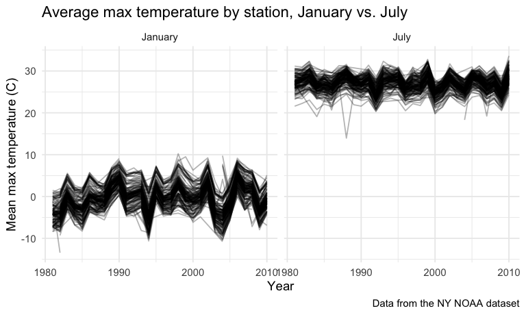
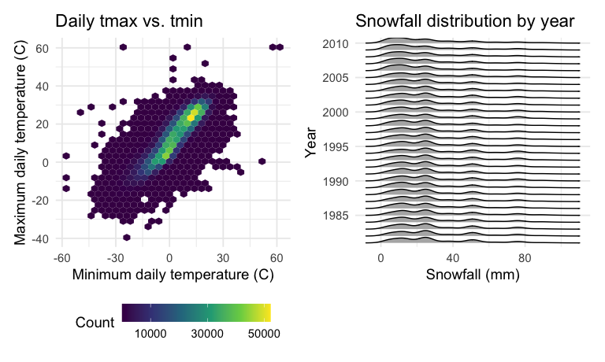

p8105_hw3_sm5975
================
Sania Sheifuddin
2026-10-17

# Question 1

## For the Setup

``` r
library(tidyverse)
```

    ## ── Attaching core tidyverse packages ──────────────────────── tidyverse 2.0.0 ──
    ## ✔ dplyr     1.2.1     ✔ readr     2.2.0
    ## ✔ forcats   1.0.1     ✔ stringr   1.6.0
    ## ✔ ggplot2   4.0.3     ✔ tibble    3.3.1
    ## ✔ lubridate 1.9.5     ✔ tidyr     1.3.2
    ## ✔ purrr     1.2.2     
    ## ── Conflicts ────────────────────────────────────────── tidyverse_conflicts() ──
    ## ✖ dplyr::filter() masks stats::filter()
    ## ✖ dplyr::lag()    masks stats::lag()
    ## ℹ Use the conflicted package (<http://conflicted.r-lib.org/>) to force all conflicts to become errors

``` r
library(p8105.datasets)
library(patchwork)
library(ggridges)

knitr::opts_chunk$set(
  fig.width = 8,
  fig.asp = .6,
  out.width = "90%"
)

theme_set(theme_minimal(base_size = 14) + theme(legend.position = "bottom"))

options(
  ggplot2.continuous.colour = "viridis",
  ggplot2.continuous.fill = "viridis"
)

scale_colour_discrete = scale_colour_viridis_d
scale_fill_discrete = scale_fill_viridis_d

data("ny_noaa")
```

## Data Description

``` r
ny_noaa |> 
  summarize(across(everything(), ~ mean(is.na(.)))) |> 
  pivot_longer(
    everything(),
    names_to = "variable",
    values_to = "prop_missing") |> 
  knitr::kable(digits = 2)
```

| variable | prop_missing |
|:---------|-------------:|
| id       |         0.00 |
| date     |         0.00 |
| prcp     |         0.06 |
| snow     |         0.15 |
| snwd     |         0.23 |
| tmax     |         0.44 |
| tmin     |         0.44 |

``` r
n_distinct(ny_noaa$id)
```

    ## [1] 747

``` r
range(ny_noaa$date)
```

    ## [1] "1981-01-01" "2010-12-31"

The dataset has 2,595,176 rows and 7 columns, with daily weather
observations from `747` New York stations between 1981 and 2010 . Key
variables include id (station), date, prcp (precipitation in tenths of
mm), snow (snowfall in mm), snwd (snow depth in mm), and tmax/tmin
(tenths of °C). Missingness is large, especially for tmax and tmin
(found to be 44% each), snwd (23%), and snow (15%), while prcp is
missing less often (6%). There are many stations that didn’t record all
variables, due to this the summaries need na.rm = TRUE.

## Cleaning

``` r
noaa_df = 
  ny_noaa |> 
  separate(date, into = c("year", "month", "day"), sep = "-", convert = TRUE) |> 
  mutate(
    prcp = prcp / 10,
    tmax = as.numeric(tmax) / 10,
    tmin = as.numeric(tmin) / 10)

noaa_df |> 
  count(snow, name = "n_obs") |> 
  arrange(desc(n_obs))
```

    ## # A tibble: 282 × 2
    ##     snow   n_obs
    ##    <int>   <int>
    ##  1     0 2008508
    ##  2    NA  381221
    ##  3    25   31022
    ##  4    13   23095
    ##  5    51   18274
    ##  6    76   10173
    ##  7     8    9962
    ##  8     5    9748
    ##  9    38    9197
    ## 10     3    8790
    ## # ℹ 272 more rows

The most commonly observed snowfall value is 0, because most days in New
York have no snowfall. NA is the second most common (381,221
observations), as a lot of stations don’t even record the snowfall.
Among nonzero values, the most common are 25 mm, 13 mm, 51 mm and 76 mm.

## Mean tmax by station in January and July

``` r
tmax_station_df = 
  noaa_df |> 
  filter(month %in% c(1, 7)) |> 
  mutate(month = if_else(month == 1, "January", "July")) |> 
  group_by(id, month, year) |> 
  summarize(mean_tmax = mean(tmax, na.rm = TRUE)) |> 
  ungroup()
```

    ## `summarise()` has regrouped the output.
    ## ℹ Summaries were computed grouped by id, month, and year.
    ## ℹ Output is grouped by id and month.
    ## ℹ Use `summarise(.groups = "drop_last")` to silence this message.
    ## ℹ Use `summarise(.by = c(id, month, year))` for per-operation grouping
    ##   (`?dplyr::dplyr_by`) instead.

``` r
tmax_station_df |> 
  ggplot(aes(x = year, y = mean_tmax, group = id)) + 
  geom_line(alpha = .3) + 
  facet_grid(. ~ month) + 
  labs(
    title = "Average max temperature by station, January vs. July",
    x = "Year",
    y = "Mean max temperature (C)",
    caption = "Data from the NY NOAA dataset"
  )
```

    ## Warning: Removed 5932 rows containing missing values or values outside the scale range
    ## (`geom_line()`).



``` r
tmax_station_df |> 
  group_by(month) |> 
  filter(min_rank(mean_tmax) < 4)
```

    ## # A tibble: 6 × 4
    ## # Groups:   month [2]
    ##   id          month    year mean_tmax
    ##   <chr>       <chr>   <int>     <dbl>
    ## 1 USC00301723 January  1982     -13.4
    ## 2 USC00302454 July     2004      18.3
    ## 3 USC00305925 January  2005     -12.2
    ## 4 USC00306957 January  2004     -10.8
    ## 5 USC00308946 July     1984      19.1
    ## 6 USC00308962 July     1988      14.0

The average max temperatures in January range from around (-13°C to
10°C), while July averages cluster between arounf 22°C and 32°C.
Stations move together from year to year, with warm and cold years
showing up across nearly all stations. This points to regional weather,
rather than station-specific differences, as the main driver of the
pattern. Both year-to-year and station-to-station variation are much
greater in January than in July.The lowest values in each month stand
out as outliers. In January, station USC00301723 in 1982 has the lowest
average (-13.4°C), followed by USC00305925 in 2005 (-12.2°C) and
USC00306957 in 2004 (-10.8°C). In July, station USC00308962 in 1988 has
an average of 14.0°C, far below the typical range, and USC00302454 in
2004 (18.3°C) and USC00308946 in 1984 (19.1°C) are also unusually low.

## tmax vs tmin - snowfall by year

``` r
ggp_temp = 
  noaa_df |> 
  ggplot(aes(x = tmin, y = tmax)) + 
  geom_hex() + 
  scale_fill_continuous(breaks = c(10000, 30000, 50000)) + 
  labs(
    title = "Daily tmax vs. tmin",
    x = "Minimum daily temperature (C)",
    y = "Maximum daily temperature (C)",
    fill = "Count"
  ) + 
  theme(legend.key.width = unit(1, "cm"))
ggp_snow = 
  noaa_df |> 
  filter(snow > 0, snow < 100) |> 
  ggplot(aes(x = snow, y = factor(year))) + 
  geom_density_ridges(scale = .85) + 
  scale_y_discrete(breaks = seq(1985, 2010, 5)) + 
  labs(
    title = "Snowfall distribution by year",
    x = "Snowfall (mm)",
    y = "Year"
  )

ggp_temp + ggp_snow
```

    ## Warning: Removed 1136276 rows containing non-finite outside the scale range
    ## (`stat_binhex()`).

    ## Picking joint bandwidth of 3.76


The hex plot shows the density and this plot shows us that tmax and tmin
are positively related.Most observations are concentrated in a single
band roughly 10 to 25°C for both. The yearly snowfall distributions look
very similar to one another. All are right-skewed.
