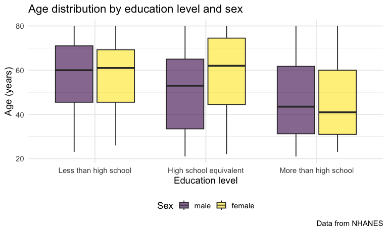
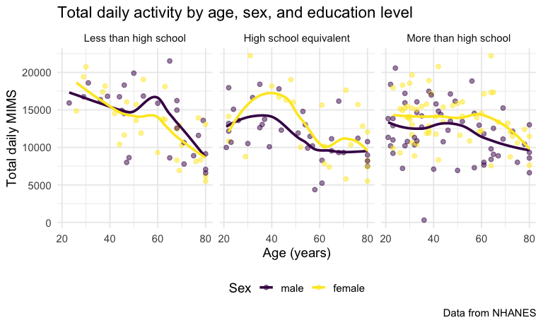
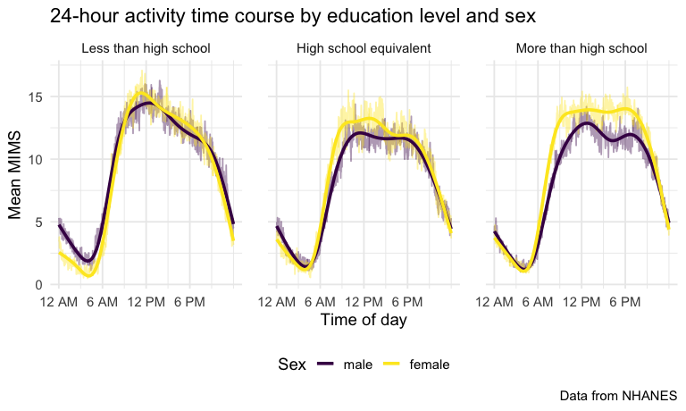
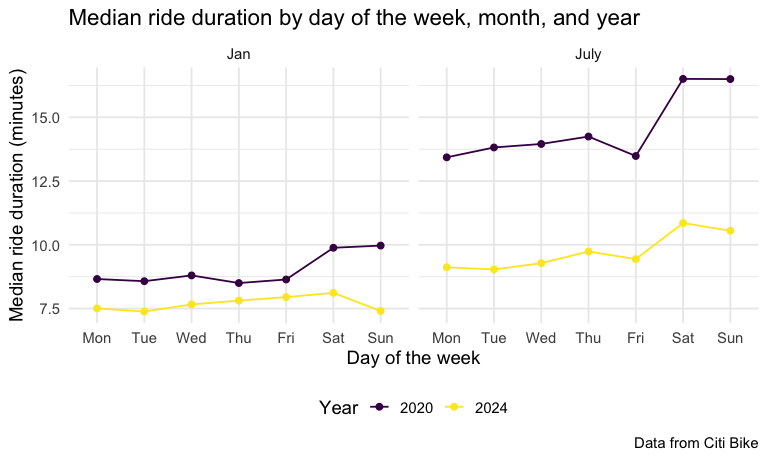
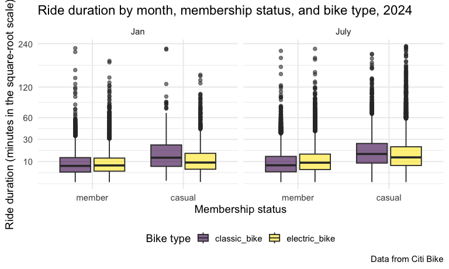

p8105_hw3_sm5975
================
Sania Sheifuddin
2026-10-17

# Question 1

## For the Setup

``` r
library(tidyverse)
```

    ## ── Attaching core tidyverse packages ──────────────────────── tidyverse 2.0.0 ──
    ## ✔ dplyr     1.2.1     ✔ readr     2.2.0
    ## ✔ forcats   1.0.1     ✔ stringr   1.6.0
    ## ✔ ggplot2   4.0.3     ✔ tibble    3.3.1
    ## ✔ lubridate 1.9.5     ✔ tidyr     1.3.2
    ## ✔ purrr     1.2.2     
    ## ── Conflicts ────────────────────────────────────────── tidyverse_conflicts() ──
    ## ✖ dplyr::filter() masks stats::filter()
    ## ✖ dplyr::lag()    masks stats::lag()
    ## ℹ Use the conflicted package (<http://conflicted.r-lib.org/>) to force all conflicts to become errors

``` r
library(p8105.datasets)
library(patchwork)
library(ggridges)

knitr::opts_chunk$set(
  fig.width = 8,
  fig.asp = .6,
  out.width = "90%"
)

theme_set(theme_minimal(base_size = 14) + theme(legend.position = "bottom"))

options(
  ggplot2.continuous.colour = "viridis",
  ggplot2.continuous.fill = "viridis"
)

scale_colour_discrete = scale_colour_viridis_d
scale_fill_discrete = scale_fill_viridis_d

data("ny_noaa")
```

## Data Description

``` r
ny_noaa |> 
  summarize(across(everything(), ~ mean(is.na(.)))) |> 
  pivot_longer(
    everything(),
    names_to = "variable",
    values_to = "prop_missing") |> 
  knitr::kable(digits = 2)
```

| variable | prop_missing |
|:---------|-------------:|
| id       |         0.00 |
| date     |         0.00 |
| prcp     |         0.06 |
| snow     |         0.15 |
| snwd     |         0.23 |
| tmax     |         0.44 |
| tmin     |         0.44 |

``` r
n_distinct(ny_noaa$id)
```

    ## [1] 747

``` r
range(ny_noaa$date)
```

    ## [1] "1981-01-01" "2010-12-31"

The dataset has 2,595,176 rows and 7 columns, with daily weather
observations from `747` New York stations between 1981 and 2010 . Key
variables include id (station), date, prcp (precipitation in tenths of
mm), snow (snowfall in mm), snwd (snow depth in mm), and tmax/tmin
(tenths of °C). Missingness is large, especially for tmax and tmin
(found to be 44% each), snwd (23%), and snow (15%), while prcp is
missing less often (6%). There are many stations that didn’t record all
variables, due to this the summaries need na.rm = TRUE.

## Cleaning

``` r
noaa_df = 
  ny_noaa |> 
  separate(date, into = c("year", "month", "day"), sep = "-", convert = TRUE) |> 
  mutate(
    prcp = prcp / 10,
    tmax = as.numeric(tmax) / 10,
    tmin = as.numeric(tmin) / 10)

noaa_df |> 
  count(snow, name = "n_obs") |> 
  arrange(desc(n_obs))
```

    ## # A tibble: 282 × 2
    ##     snow   n_obs
    ##    <int>   <int>
    ##  1     0 2008508
    ##  2    NA  381221
    ##  3    25   31022
    ##  4    13   23095
    ##  5    51   18274
    ##  6    76   10173
    ##  7     8    9962
    ##  8     5    9748
    ##  9    38    9197
    ## 10     3    8790
    ## # ℹ 272 more rows

The most commonly observed snowfall value is 0, because most days in New
York have no snowfall. NA is the second most common (381,221
observations), as a lot of stations don’t even record the snowfall.
Among nonzero values, the most common are 25 mm, 13 mm, 51 mm and 76 mm.
These correspond to 1, ½, 2, and 3 inches, which is indicitave of the
fact that snowfall was recorded in inches and converted to millimeters.

## Mean tmax by station in January and July

``` r
tmax_station_df = 
  noaa_df |> 
  filter(month %in% c(1, 7)) |> 
  mutate(month = if_else(month == 1, "January", "July")) |> 
  group_by(id, month, year) |> 
  summarize(mean_tmax = mean(tmax, na.rm = TRUE)) |> 
  ungroup()
```

    ## `summarise()` has regrouped the output.
    ## ℹ Summaries were computed grouped by id, month, and year.
    ## ℹ Output is grouped by id and month.
    ## ℹ Use `summarise(.groups = "drop_last")` to silence this message.
    ## ℹ Use `summarise(.by = c(id, month, year))` for per-operation grouping
    ##   (`?dplyr::dplyr_by`) instead.

``` r
tmax_station_df |> 
  ggplot(aes(x = year, y = mean_tmax, group = id)) + 
  geom_line(alpha = .3) + 
  facet_grid(. ~ month) + 
  labs(
    title = "Average max temperature by station, January vs. July",
    x = "Year",
    y = "Mean max temperature (C)",
    caption = "Data from the NY NOAA dataset"
  )
```

    ## Warning: Removed 5932 rows containing missing values or values outside the scale range
    ## (`geom_line()`).


``` r
tmax_station_df |> 
  group_by(month) |> 
  filter(min_rank(mean_tmax) < 4)
```

    ## # A tibble: 6 × 4
    ## # Groups:   month [2]
    ##   id          month    year mean_tmax
    ##   <chr>       <chr>   <int>     <dbl>
    ## 1 USC00301723 January  1982     -13.4
    ## 2 USC00302454 July     2004      18.3
    ## 3 USC00305925 January  2005     -12.2
    ## 4 USC00306957 January  2004     -10.8
    ## 5 USC00308946 July     1984      19.1
    ## 6 USC00308962 July     1988      14.0

The average max temperatures in January range from around (-13°C to
10°C), while July averages cluster between arounf 22°C and 32°C.
Stations move together from year to year, with warm and cold years
showing up across nearly all stations. This points to regional weather,
rather than station-specific differences, as the main driver of the
pattern. Both year-to-year and station-to-station variation are much
greater in January than in July.The lowest values in each month stand
out as outliers. In January, station USC00301723 in 1982 has the lowest
average (-13.4°C), followed by USC00305925 in 2005 (-12.2°C) and
USC00306957 in 2004 (-10.8°C). In July, station USC00308962 in 1988 has
an average of 14.0°C, far below the typical range, and USC00302454 in
2004 (18.3°C) and USC00308946 in 1984 (19.1°C) are also unusually low.

## tmax vs tmin - snowfall by year

``` r
ggp_temp = 
  noaa_df |> 
  ggplot(aes(x = tmin, y = tmax)) + 
  geom_hex() + 
  scale_fill_continuous(breaks = c(10000, 30000, 50000)) + 
  labs(
    title = "Daily tmax vs. tmin",
    x = "Minimum daily temperature (C)",
    y = "Maximum daily temperature (C)",
    fill = "Count"
  ) + 
  theme(legend.key.width = unit(1, "cm"))
ggp_snow = 
  noaa_df |> 
  filter(snow > 0, snow < 100) |> 
  ggplot(aes(x = snow, y = factor(year))) + 
  geom_density_ridges(scale = .85) + 
  scale_y_discrete(breaks = seq(1985, 2010, 5)) + 
  labs(
    title = "Snowfall distribution by year",
    x = "Snowfall (mm)",
    y = "Year"
  )

ggp_temp + ggp_snow
```

    ## Warning: Removed 1136276 rows containing non-finite outside the scale range
    ## (`stat_binhex()`).

    ## Picking joint bandwidth of 3.76


The hex plot shows the density and this plot shows us that tmax and tmin
are positively related.Most observations are concentrated in a single
band roughly 10 to 25°C for both. The yearly snowfall distributions look
very similar to one another. All are right-skewed. A few outliers
appear, such as tmax near 60°C and some days with tmin above tmax.

# Question 2

``` r
covar_df = 
  read_csv("./data/nhanes_covar.csv", skip = 4) |> 
  janitor::clean_names() |> 
  filter(age >= 21) |> 
  drop_na() |> 
  mutate(
    sex = 
      case_match(
        sex, 
        1 ~ "male", 
        2 ~ "female"),
    sex = factor(sex, levels = c("male", "female")),
    education = 
      case_match(
        education, 
        1 ~ "Less than high school", 
        2 ~ "High school equivalent", 
        3 ~ "More than high school"),
    education = factor(
      education, 
      levels = c("Less than high school", "High school equivalent", "More than high school")))
```

    ## Rows: 250 Columns: 5
    ## ── Column specification ────────────────────────────────────────────────────────
    ## Delimiter: ","
    ## dbl (5): SEQN, sex, age, BMI, education
    ## 
    ## ℹ Use `spec()` to retrieve the full column specification for this data.
    ## ℹ Specify the column types or set `show_col_types = FALSE` to quiet this message.

    ## Warning: There was 1 warning in `mutate()`.
    ## ℹ In argument: `sex = case_match(sex, 1 ~ "male", 2 ~ "female")`.
    ## Caused by warning:
    ## ! `case_match()` was deprecated in dplyr 1.2.0.
    ## ℹ Please use `recode_values()` instead.

``` r
accel_df = 
  read_csv("./data/nhanes_accel.csv") |> 
  janitor::clean_names()
```

    ## Rows: 250 Columns: 1441
    ## ── Column specification ────────────────────────────────────────────────────────
    ## Delimiter: ","
    ## dbl (1441): SEQN, min1, min2, min3, min4, min5, min6, min7, min8, min9, min1...
    ## 
    ## ℹ Use `spec()` to retrieve the full column specification for this data.
    ## ℹ Specify the column types or set `show_col_types = FALSE` to quiet this message.

``` r
nhanes_df = 
  left_join(covar_df, accel_df, by = "seqn")
```

``` r
nhanes_summary = 
  nhanes_df |> 
  summarize(
    n_participants = n(),
    n_male = sum(sex == "male"),
    n_female = sum(sex == "female"))
```

The final dataset includes 228 participants aged 21 or older with
complete demographic data (118 male and 110 female), out of the 250
originally observed. It contains all original variables: participant ID
(seqn), sex, age, BMI, education, and the MIMS values for each of the
1,440 minutes of the day (min1 to min1440). Sex and education are
factors, ordered by education level for tables and plots.

## Visualization of the age distributions

``` r
nhanes_df |> 
  count(education, sex) |> 
  pivot_wider(
    names_from = sex,
    values_from = n) |> 
  knitr::kable()
```

| education              | male | female |
|:-----------------------|-----:|-------:|
| Less than high school  |   27 |     28 |
| High school equivalent |   35 |     23 |
| More than high school  |   56 |     59 |

``` r
nhanes_df |> 
  ggplot(aes(x = education, y = age, fill = sex)) + 
  geom_boxplot(alpha = .6) + 
  labs(
    title = "Age distribution by education level and sex",
    x = "Education level",
    y = "Age (years)",
    fill = "Sex",
    caption = "Data from NHANES"
  )
```


The sample is relatively balanced between men and women in the less than
high school (27 men, 28 women) and more than high school (56 men, 59
women) groups, while the high school equivalent group has more men than
women which is slightly different than the other groups (35 vs. 23).
Most participants have more than high school education. Median age is
similar for men and women in the less than high school group (about 60),
and participants with more than high school education are younger
(median is among the low 40s). In the high school equivalent group,
women are older than men (median about 60 for women whereas the median
for men lies in the 50s range).

## Total activity variable for each participant

``` r
total_df = 
  nhanes_df |> 
  pivot_longer(
    min1:min1440,
    names_to = "minute",
    names_prefix = "min",
    values_to = "mims") |> 
  group_by(seqn, sex, age, education) |> 
  summarize(total_activity = sum(mims)) |> 
  ungroup()
```

    ## `summarise()` has regrouped the output.
    ## ℹ Summaries were computed grouped by seqn, sex, age, and education.
    ## ℹ Output is grouped by seqn, sex, and age.
    ## ℹ Use `summarise(.groups = "drop_last")` to silence this message.
    ## ℹ Use `summarise(.by = c(seqn, sex, age, education))` for per-operation
    ##   grouping (`?dplyr::dplyr_by`) instead.

``` r
total_df |> 
  ggplot(aes(x = age, y = total_activity, color = sex)) + 
  geom_point(alpha = .5) + 
  geom_smooth(se = FALSE) + 
  facet_grid(. ~ education) + 
  labs(
    title = "Total daily activity by age, sex, and education level",
    x = "Age (years)",
    y = "Total daily MIMS",
    color = "Sex",
    caption = "Data from NHANES"
  )
```

    ## `geom_smooth()` using method = 'loess' and formula = 'y ~ x'


Total activity is seen to decline with age in all three groups, but the
shape is a bit different from each other. In the less than high school
group, activity falls steadily and men and women follow similar curves.
In the high school equivalent group, women are more active than men
until about age 55, and then both drop and overlap by a bit. In the more
than high school group, activity is relativly flat until about age 60
and then declines more. Women are more active than men across most of
the age range and then the two groups end up converge by age 80.
Individual values vary widely at every age, so the trendline/smooth
describe averages only. One man in the more than high school group,
around age 40 years of age, has a total close to zero making this person
a heavy outlier and could also potentially mean the device was not worn
properly.

``` r
nhanes_long_df = 
  nhanes_df |> 
  pivot_longer(
    min1:min1440,
    names_to = "minute",
    names_prefix = "min",
    values_to = "mims") |> 
  mutate(minute = as.numeric(minute))

nhanes_long_df |> 
  group_by(education, sex, minute) |> 
  summarize(mean_mims = mean(mims)) |> 
  ggplot(aes(x = minute, y = mean_mims, color = sex)) + 
  geom_line(alpha = .4) + 
  geom_smooth(se = FALSE) + 
  facet_grid(. ~ education) + 
  scale_x_continuous(
  breaks = c(0, 360, 720, 1080),
  labels = c("12 AM", "6 AM", "12 PM", "6 PM")) + 
 labs(
  title = "24-hour activity time course by education level and sex",
  x = "Time of day",
  y = "Mean MIMS",
  color = "Sex",
  caption = "Data from NHANES"
)+
  theme(panel.spacing = unit(1.5, "lines"))
```

    ## `summarise()` has regrouped the output.
    ## `geom_smooth()` using method = 'gam' and formula = 'y ~ s(x, bs = "cs")'
    ## ℹ Summaries were computed grouped by education, sex, and minute.
    ## ℹ Output is grouped by education and sex.
    ## ℹ Use `summarise(.groups = "drop_last")` to silence this message.
    ## ℹ Use `summarise(.by = c(education, sex, minute))` for per-operation grouping
    ##   (`?dplyr::dplyr_by`) instead.


As we can see, in all the groups, activity is lowest in the early
morning and then proceeds to rise, stays high through the middle of the
day, and declines through the evening. there is a difference that can be
noticed in the patter with the addition of Education level and sex
change. In the less than high school group, activity peaks later morning
and falls steadily afterward. Men and women are similar during the day,
but men are more active overnight and at the end of the day. In the high
school equivalent group, women are more active than men from the morning
rise until mid-afternoon, and the two groups converge in the evening. In
the more than high school group, the sex gap is largest and lasts longer
as well. In the two higher education groups, women activity also start
to rise earlier in the morning than men. The less than high school group
declines earliest in comparison.

# Question 3

``` r
jan_2020_df = 
  read_csv("./data/citibike/Jan 2020 Citi.csv.zip", show_col_types = FALSE) |> 
  janitor::clean_names() |> 
  mutate(month = "Jan", year = 2020)

july_2020_df = 
  read_csv("./data/citibike/July 2020 Citi.csv.zip", show_col_types = FALSE) |> 
  janitor::clean_names() |> 
  mutate(month = "July", year = 2020)

jan_2024_df = 
  read_csv("./data/citibike/Jan 2024 Citi.csv.zip", show_col_types = FALSE) |> 
  janitor::clean_names() |> 
  mutate(month = "Jan", year = 2024)

july_2024_df = 
  read_csv("./data/citibike/July 2024 Citi.csv.zip", show_col_types = FALSE) |> 
  janitor::clean_names() |> 
  mutate(month = "July", year = 2024)

citibike_df = 
  bind_rows(jan_2020_df, july_2020_df, jan_2024_df, july_2024_df) |> 
  mutate(
    month = factor(month, levels = c("Jan", "July")),
    weekdays = factor(
      weekdays, 
      levels = c("Monday", "Tuesday", "Wednesday", "Thursday", "Friday", "Saturday", "Sunday")),
    rideable_type = factor(rideable_type, levels = c("classic_bike", "electric_bike")),
    member_casual = factor(member_casual, levels = c("member", "casual"))) |> 
  select(ride_id, year, month, weekdays, everything())

citibike_df
```

    ## # A tibble: 99,485 × 9
    ##    ride_id         year month weekdays rideable_type duration start_station_name
    ##    <chr>          <dbl> <fct> <fct>    <fct>            <dbl> <chr>             
    ##  1 4BE06CB33B037…  2020 Jan   Tuesday  classic_bike     15.3  Columbus Ave & W …
    ##  2 26886E0349744…  2020 Jan   Wednesd… classic_bike      5.31 2 Ave & E 96 St   
    ##  3 24DC56060EBE6…  2020 Jan   Friday   classic_bike      9.69 Columbia St & Riv…
    ##  4 EEDC1053582D0…  2020 Jan   Sunday   classic_bike      7.00 W 84 St & Columbu…
    ##  5 2CD4BD4CEE2E5…  2020 Jan   Friday   classic_bike      2.85 Forsyth St & Broo…
    ##  6 E18682F9A4E50…  2020 Jan   Sunday   classic_bike     25.5  Allen St & Hester…
    ##  7 B9B2E8960A71A…  2020 Jan   Sunday   classic_bike      3.65 Lafayette St & Je…
    ##  8 DEF8F50495E64…  2020 Jan   Sunday   classic_bike     38.3  28 Ave & 44 St    
    ##  9 17D44DA993F32…  2020 Jan   Thursday classic_bike     38.5  Barrow St & Hudso…
    ## 10 0FD113A309327…  2020 Jan   Tuesday  classic_bike      6.52 Carlton Ave & Par…
    ## # ℹ 99,475 more rows
    ## # ℹ 2 more variables: end_station_name <chr>, member_casual <fct>

``` r
citibike_df |> 
  summarize(
    mean_duration = mean(duration),
    median_duration = median(duration),
    max_duration = max(duration))
```

    ## # A tibble: 1 × 3
    ##   mean_duration median_duration max_duration
    ##           <dbl>           <dbl>        <dbl>
    ## 1          13.9            9.84         239.

The cleaned dataset has 99485 rides drawn from four samples: January and
July of 2020 and 2024. Each row is one ride. Variables are the ride ID,
the year and month of the sample, the day of the week (weekdays), the
bike type (rideable_type: classic or electric), the ride duration in
minutes (duration), the start and end station names, and rider type
(member_casual). 43 rides are missing a start station name and 207 are
missing an end station name, and no other variable has missing values.
There is a median of about 9.8 minutes and a maximum of about 239
minutes.

## Rides in each combination of year and month separating casual riders and Citi Bike members

``` r
citibike_df |> 
  count(year, month, member_casual) |> 
  pivot_wider(
    names_from = member_casual,
    values_from = n) |> 
  knitr::kable()
```

| year | month | member | casual |
|-----:|:------|-------:|-------:|
| 2020 | Jan   |  11436 |    984 |
| 2020 | July  |  15411 |   5637 |
| 2024 | Jan   |  16753 |   2108 |
| 2024 | July  |  36262 |  10894 |

Members take a lot more rides than casual riders in every month
observed. However, there is a much larger share in July among casual
riders as compared to Jan. The number of rides is higher in summer than
in winter for both groups, and the difference is larger for casual
riders. Rides also grew over the years between 2020 and 2024.

## The 5 most popular starting stations for July 2024

``` r
citibike_df |> 
  filter(year == 2024, month == "July") |> 
  count(start_station_name, name = "n_rides") |> 
  filter(min_rank(desc(n_rides)) < 6) |> 
  arrange(desc(n_rides)) |> 
  knitr::kable()
```

| start_station_name       | n_rides |
|:-------------------------|--------:|
| Pier 61 at Chelsea Piers |     163 |
| University Pl & E 14 St  |     155 |
| W 21 St & 6 Ave          |     152 |
| West St & Chambers St    |     150 |
| W 31 St & 7 Ave          |     146 |

The top five are close together, from 146 to 163 sampled rides.

## Plot to investigate the effects of day of the week, month, and year on median ride duration.

``` r
citibike_df |> 
  group_by(year, month, weekdays) |> 
  summarize(median_duration = median(duration)) |> 
  ungroup() |> 
  mutate(year = factor(year)) |> 
  ggplot(aes(x = weekdays, y = median_duration, color = year, group = year)) +
  geom_point() + 
  geom_line() + 
  facet_grid(. ~ month) + 
  scale_x_discrete(labels = c("Mon", "Tue", "Wed", "Thu", "Fri", "Sat", "Sun")) + 
  labs(
    title = "Median ride duration by day of the week, month, and year",
    x = "Day of the week",
    y = "Median ride duration (minutes)",
    color = "Year",
    caption = "Data from Citi Bike"
  )
```

    ## `summarise()` has regrouped the output.
    ## ℹ Summaries were computed grouped by year, month, and weekdays.
    ## ℹ Output is grouped by year and month.
    ## ℹ Use `summarise(.groups = "drop_last")` to silence this message.
    ## ℹ Use `summarise(.by = c(year, month, weekdays))` for per-operation grouping
    ##   (`?dplyr::dplyr_by`) instead.


July rides are longer than January rides in both years, and 2020 rides
are longer than 2024 rides in when comparing the same month. In 2020,
weekend rides are longer than weekday rides. In July 2024, weekend rides
are also longer whereas in January 2024 there is no clear weekend
pattern, since Saturday is the highest day and Sunday is the lowest.
Overall, the weekend effect is largest in summer, and the gap between
2020 and 2024 is larger than the gap between any two days of the week.

## Impact of month, membership status, and bike type on the distribution of ride duration

``` r
citibike_df |> 
  filter(year == 2024) |> 
  ggplot(aes(x = member_casual, y = duration, fill = rideable_type)) + 
  geom_boxplot(alpha = .6) + 
  facet_grid(. ~ month) + 
  scale_y_continuous(
    trans = "sqrt",
    breaks = c(0, 10, 30, 60, 120, 240)) + 
  labs(
    title = "Ride duration by month, membership status, and bike type, 2024",
    x = "Membership status",
    y = "Ride duration (minutes in the square-root scale)",
    fill = "Bike type",
    caption = "Data from Citi Bike"
  )
```


As seen on the graph, membership status has the largest effect on ride
duration. Casual riders based on the median seen take longer rides than
members in every month and on both bike types. Bike type matters
differently by membership. Among casual riders, classic bikes are used
for longer rides than electric bikes. Among the members, the two bike
types are closer to each other and doesn’t show too much of a
difference, with electric bikes slightly longer in July and very similar
in January . Month also matters as we can see that July rides are longer
than January rides for casual riders on both bike types and for members
on electric bikes, while member rides on classic bikes change little.
